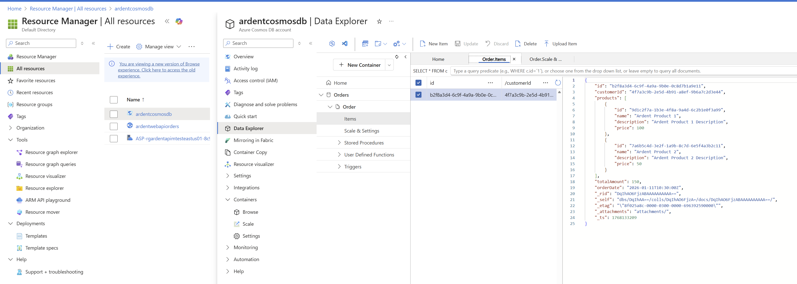

# Order API Overview

CRUD API demonstrating clean architecture and Azure CosmosDB integration with Azure Function event handling.

## Example API endpoint (HTTP GET):
https://ardentwebapiorders-fwhbcedxc2fnfhaj.eastus-01.azurewebsites.net/api/order/b2f8a3d4-6c9f-4a9a-9b0e-0c8d7b1a9e11/customer/4f7a3c9b-2e5d-4b91-a8ef-9b6a7c2d3e44

## Example order (Azure Cosmos DB document):

```
{
  "id": "b2f8a3d4-6c9f-4a9a-9b0e-0c8d7b1a9e11",
  "customerId": "4f7a3c9b-2e5d-4b91-a8ef-9b6a7c2d3e44",
   "products": [
       {
           "id": "9d1c2f7a-1b3e-4f8a-9a4d-6c2b1e0f3a99",
           "name": "Ardent Product 1",
           "description": "Ardent Product 1 Description",
           "price": 100
       },
       {
           "id": "7a6b5c4d-3e2f-1a9b-8c7d-6e5f4a3b2c11",
           "name": "Ardent Product 2",
           "description": "Ardent Product 2 Description",
           "price": 50
       }
   ],
  "totalAmount": 150.00,
  "orderDate": "2026-01-11T10:30:00Z"
}
```



## Claude Desktop and Order MCP Server Integration

Customer service representative retrieving and creating new customers order via Claude Desktop interface and Order MCP Server.


Order creation over MCP verified within Cosmos DB


